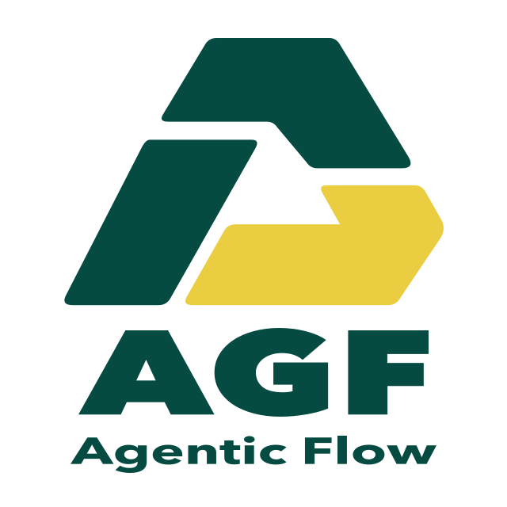
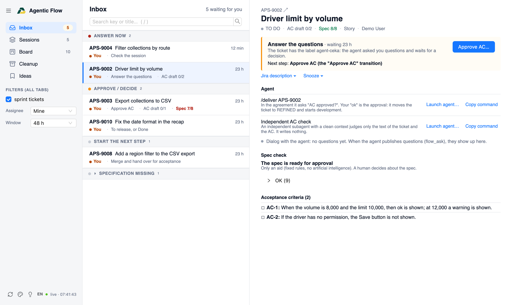
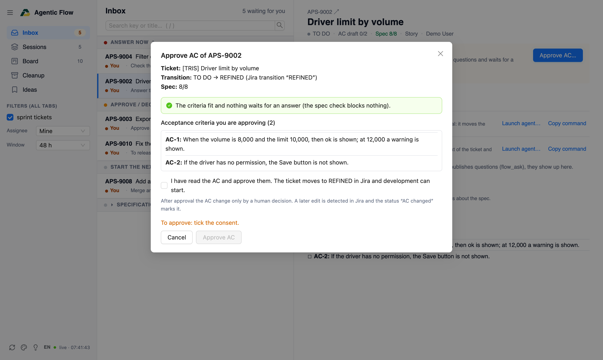
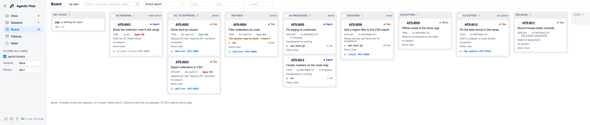
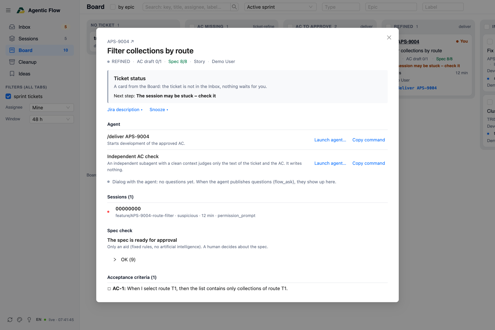
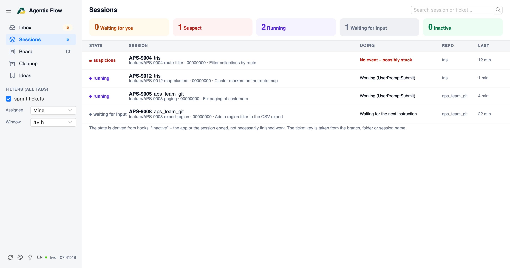

<p align="center">
  
</p>

<h1 align="center">AGF – Agentic Flow</h1>

<p align="center">
  A local control room for <b>Claude Code</b> agents and <b>Jira</b> refinement.<br>
  See what every agent is doing, approve acceptance criteria, answer agent questions and launch sessions – from one page.
</p>

<p align="center">
  
</p>

> The interface is English by default with a CS / EN switch in the sidebar footer (the choice is remembered). The screenshots show invented demo data.

## What it does

When several Claude Code agents work on Jira tickets at once, the hard part is knowing **who has the ball**. AGF answers that:

- **Inbox** – only what waits for *you*, ordered by urgency: an agent question, an approval, a stuck session.
- **Sessions & Board** – live state of every Claude Code session (running / waiting / idle / stuck) and your Jira tickets in columns by status. Search, filters, sprints and backlog like in Jira.
- **AC gate** – a ticket moves to `REFINED` only after a human approves its numbered acceptance criteria. A rule-based readiness check (no AI) shows what is missing before you decide.
- **Dialog with the agent** – the agent asks questions about the ticket, you answer in the page, the agent continues. Nothing is written to Jira until you approve.
- **Guarded agent launch** – start `/ticket-refine`, `/deliver`, `/check` for a ticket in the right repo. You see the exact folder and prompt first, and nothing starts without your click.
- **Read-only MCP server** – agents can read the same state (`flow_overview`, `flow_ticket`, `flow_ask`, …).

### One gate before development

An agent may write acceptance criteria, but a human approves them. The dialog shows exactly what is approved and which rule-based checks passed; only then does the ticket move to `REFINED`.

<p align="center">
  
</p>

### The whole flow on one board

Every ticket sits in the step it is in, with a chip that says who has the ball: **You**, **Agent** or **Other**. Each column names the skill that moves a ticket on (`ticket-refine`, `deliver`, `check`, `bp-update`) and cards that need you are flagged, including a session that looks stuck.

<p align="center">
  
</p>

### One ticket, one next step

A card opens in a window with the next step for that ticket, the agent actions (launch with a confirmation, or copy the command), its sessions, the spec check and the acceptance criteria.

<p align="center">
  
</p>

### Every agent session at a glance

Live state of each Claude Code session, linked to its ticket and repo: running, waiting for your approval, waiting for input, suspicious, inactive.

<p align="center">
  
</p>

## Design principles

- **Human in the loop.** Agents never start by themselves; every write to Jira (approval, transition) is an explicit click and is logged.
- **Local and private.** Server on `127.0.0.1`, no cloud, no telemetry. Runtime data and secrets live in `~/.flow`, outside the repo.
- **Zero build.** Python 3 standard library on the server; Vue 3 + Ant Design Vue as vendored files in the browser. No `npm install`, no bundler.

## Quick start

Requirements: macOS or Linux, Python 3, Claude Code, a Jira Cloud account with an API token.

```bash
# 1. put the CLI on your PATH
ln -s "$PWD/bin/flow" ~/.local/bin/flow

# 2. Jira credentials (file mode 600)
mkdir -p ~/.flow && printf 'JIRA_EMAIL=you@example.com\nJIRA_API_TOKEN=...\n' > ~/.flow/jira.env && chmod 600 ~/.flow/jira.env

# 3. start and open the dashboard
flow start && flow open        # http://127.0.0.1:8765/
```

### Register the hook

The session overview is fed by Claude Code hooks: `src/hook.py` appends one metadata line per event (time, event, session id, folder, branch – **no prompts, no tool input, no transcript**) to `~/.flow/events.jsonl` and never fails a session. Add it to `~/.claude/settings.json` for five events, using the **absolute path** to your clone:

```json
{
  "hooks": {
    "SessionStart":     [{ "hooks": [{ "type": "command", "command": "/usr/bin/python3 /ABSOLUTE/PATH/TO/agenticflow/src/hook.py" }] }],
    "UserPromptSubmit": [{ "hooks": [{ "type": "command", "command": "/usr/bin/python3 /ABSOLUTE/PATH/TO/agenticflow/src/hook.py" }] }],
    "Notification":     [{ "hooks": [{ "type": "command", "command": "/usr/bin/python3 /ABSOLUTE/PATH/TO/agenticflow/src/hook.py" }] }],
    "Stop":             [{ "hooks": [{ "type": "command", "command": "/usr/bin/python3 /ABSOLUTE/PATH/TO/agenticflow/src/hook.py" }] }],
    "SessionEnd":       [{ "hooks": [{ "type": "command", "command": "/usr/bin/python3 /ABSOLUTE/PATH/TO/agenticflow/src/hook.py" }] }]
  }
}
```

If the file already has a `hooks` section, add these entries to it instead of replacing it. Hooks are read when a session starts, so **restart running sessions**. Check with `flow status` (the `hooks` line and the latest-hook line, printed in Czech); new sessions then show up under Sessions within seconds.

### Optional: MCP server

Lets agents read the same state and ask you questions in the dialog. Register it once for your user:

```bash
claude mcp add --scope user flow -- /usr/bin/python3 "$PWD/src/mcp_server.py"
```

The dashboard must be running (`flow start`). Agents then get the tools `flow_overview`, `flow_ticket`, `flow_ask`, `flow_answers` and others.

Useful commands: `flow status`, `flow restart`, `flow logs`, `flow launch on|off`, `flow approve on|off`, `flow notify on|off`, `flow workmode on|off|plan`.

> Launching sessions and writing the Jira fields `WorkMode` / `NextAction` are **off by default** – switch them on once you trust the setup.

## Try it without Jira

A fake Jira and invented tickets ship with the project:

```bash
demo/start_demo.sh     # separate instance on http://127.0.0.1:8799/v2/
demo/stop_demo.sh
demo/make_video.sh launch en   # re-records a walkthrough (approve | launch) [en [cc|mute]]
```

The demo touches nothing real: its own data folder, a mock Jira, and launches are faked.

## Project layout and tests

```
bin/flow      CLI          src/      server, hook, Jira client, AC gate, MCP
web/v2/       the page     tests/    run_all.sh (no network, mock Jira)
demo/         demo + video assets/    README screenshots
```

```bash
tests/run_all.sh
```

A detailed module-by-module description (in Czech) is in [guide/README.cs.md](guide/README.cs.md).

## Status

Internal tool of a single team, shared as is. Expect Trafinoil-specific defaults (Jira project `APS`, repos `tris` and `aps_team_git`); adjust them in `src/` for your own setup.
